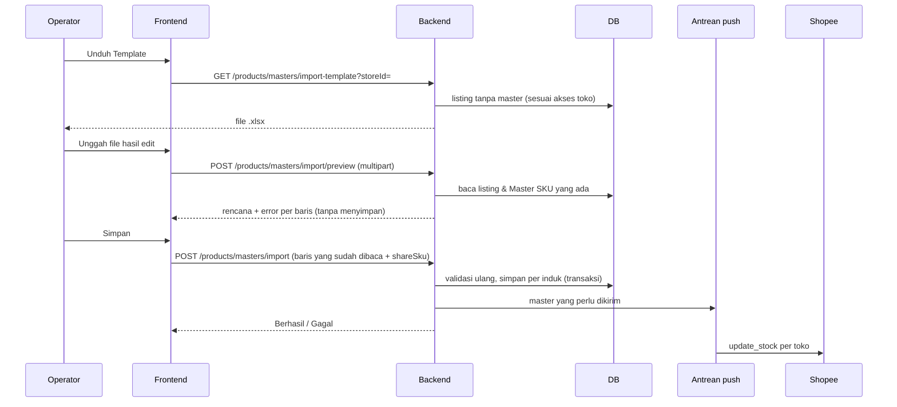

# PRD — Import Master & Stok lewat Excel

> Status: **disetujui 24 Okt 2026 (keputusan A–D sesuai usulan), sudah dibangun**
> Patokan: permintaan operator 24 Okt ("update stok & master produk pake csv… kemarin mau update stok ternyata harus di-master-in dulu, dan itu manual satu satu"), tombol Export/Import Stok di Daftar Stok Komplace, dan jawaban Rizky 24 Okt.

## 1. Overview

Stok di OrderPro hanya bisa diubah lewat master. Master dibuat satu produk per form "Jadikan Master", padahal katalognya sekitar 1.335 produk di 14 toko. Operator yang hanya ingin mengisi stok terpaksa membuat master satu per satu dulu.

Fitur ini menambah dua alur berbasis file Excel (`.xlsx`):

1. **Import Master** — unduh semua listing yang belum punya master, rapikan Master SKU di Excel, unggah. Master dibuat sekaligus. Ini yang menghilangkan kerja "satu-satu".
2. **Export/Import Stok** — unduh daftar master beserta stoknya, isi angka hasil hitung gudang, unggah. Stok tersimpan dan dikirim ke Shopee. Ini meniru tombol Export/Import Stok di Komplace.

Keduanya selalu lewat **pratinjau** sebelum menyimpan. Tidak ada perubahan skema database.

---

## 2. Keputusan yang sudah diambil (Rizky, 24 Okt 2026)

| # | Pertanyaan | Keputusan |
|---|---|---|
| 1 | Bisa impor dari export Komplace? | **Tidak**, akses Komplace sudah tidak ada. File dibuat dari data OrderPro sendiri |
| 2 | Stok saja atau sekalian master? | **Keduanya** (usulan Claude). Import Master dulu, karena tanpa master import stok tidak ada gunanya |
| 3 | Angka di file stok | **Angka akhir** hasil hitung gudang (set), bukan tambahan |
| 4 | SKU Shopee sama antartoko? | **Tidak yakin.** Jadi pratinjau wajib menunjukkan SKU yang kosong, kembar, dan stok yang berbeda antartoko |
| 5 | Format file | **`.xlsx` saja.** CSV dari Excel berbahasa Indonesia memakai pemisah `;` dan rawan rusak, jadi tidak didukung |

### Keputusan yang masih perlu dikonfirmasi (ada usulan default)

| # | Pertanyaan | Usulan |
|---|---|---|
| A | Master baru dengan SKU sama di beberapa toko, kolom Stok Awal kosong. Stok awalnya diambil dari mana? | **Yang terkecil** di antara toko-toko itu. Sama dengan aturan "stok dipakai bersama": lebih baik kurang daripada oversell. Pratinjau menunjukkan angka tiap toko |
| B | Baris dengan Master SKU kosong | **Dilewati**, bukan error. Operator bisa mengerjakan produk laris dulu, sisanya belakangan |
| C | Satu produk punya beberapa varian dengan Master SKU sama (kasus jaket + jogger) | **Ditolak**, kecuali operator mencentang "Stok dipakai bersama" di pratinjau. Sama dengan form Jadikan Master sekarang |
| D | Stok berubah antara unduh dan unggah (ada pesanan masuk) | Tetap disimpan sebagai angka akhir, tapi pratinjau **menandai** baris itu supaya operator sadar |

---

## 3. Requirements

- **Aksesibilitas:** web, halaman Produk (Import Master) dan Daftar Stok (Export/Import Stok)
- **Pengguna:** semua role. STAFF hanya melihat dan mengubah listing di toko yang boleh ia akses, sama dengan aturan halaman Produk
- **Auth:** sesi yang sudah ada
- **Data input:** file `.xlsx` hasil unduhan OrderPro yang sudah diedit di Excel atau Google Sheets (unduh sebagai .xlsx)
- **Export:** `.xlsx`
- **Constraint:**
  - Import tidak boleh menyimpan setengah jalan tanpa ketahuan. Pratinjau menunjukkan semua yang akan terjadi, lalu operator menekan Simpan
  - Listing yang sudah punya master **tidak pernah dipindah** oleh import. Mengganti master tetap lewat Lepas/Petakan di halaman Produk
  - Master SKU yang sudah ada tidak diubah stoknya oleh Import Master, hanya ditambah listing-nya (sama dengan Jadikan Master)
  - Ukuran: satu file sampai **20.000 baris** dan 10 MB

---

## 4. Core Features

### 4.1 Unduh Template Master — Must-have
Tombol **"Import Master" → "Unduh Template"** di halaman Produk. Filter toko opsional supaya file tidak terlalu besar.

Isinya semua listing yang **belum punya master**, satu baris per varian, urut per toko lalu per produk:

| Kolom | Diisi | Keterangan |
|---|---|---|
| Toko | OrderPro | Hanya untuk dibaca |
| Nama Produk | OrderPro | Nama produk di Shopee |
| Varian | OrderPro | Kosong untuk produk tanpa varian |
| SKU Shopee | OrderPro | SKU penjual di Shopee |
| Stok Shopee | OrderPro | Stok terakhir yang terbaca |
| **Master SKU** | terisi = SKU Shopee, **boleh diubah** | Kosongkan untuk melewati baris ini |
| **Nama Master Produk** | terisi = Nama Produk, **boleh diubah** | Baris dengan nama sama jadi satu induk |
| **Stok Awal** | kosong, **boleh diisi** | Kosong = ambil dari Stok Shopee |
| ID (jangan diubah) | OrderPro | Kunci listing. Paling kanan, abu-abu |

- Kolom SKU diformat sebagai **teks**, supaya Excel tidak membuang nol di depan (`001234`) atau mengubahnya jadi angka ilmiah
- Baris pertama berisi judul kolom dan dibekukan. Sheet kedua "Petunjuk" menjelaskan cara mengisi

### 4.2 Unggah & Pratinjau Master — Must-have
Operator mengunggah file. Server membaca dan mengembalikan rencana, **tanpa menyimpan apa pun**:

- **Akan dibuat:** jumlah Master SKU baru dan induknya
- **Digabung ke master yang sudah ada:** Master SKU yang sudah ada di OrderPro
- **Digabung antartoko:** satu Master SKU dipakai listing di beberapa toko. Kalau stoknya berbeda, tampilkan angka tiap toko dan angka yang dipakai (keputusan A)
- **Dilewati:** Master SKU kosong, atau listing sudah punya master (misalnya dipetakan orang lain setelah file diunduh)
- **Error, harus dibetulkan:**
  - ID tidak dikenal atau di luar toko yang boleh diakses
  - Stok Awal bukan angka bulat ≥ 0
  - Satu Master SKU baru diberi Stok Awal berbeda di baris berbeda
  - Varian dalam satu produk memakai Master SKU sama, dan "Stok dipakai bersama" tidak dicentang (keputusan C)

Selama masih ada error, tombol Simpan mati. Daftar error menyebut nomor baris Excel, supaya mudah dicari.

### 4.3 Simpan Master — Must-have
- Server **memvalidasi ulang** dari awal, karena data bisa berubah sejak pratinjau
- Logikanya memakai ulang `planMasterFromItem` dan `existingMastersBySku`: satu Master SKU baru per kelompok, listing lain ikut ke master itu
- Disimpan per induk dalam transaksi masing-masing. Hasilnya dilaporkan seperti Jadikan Master: "Berhasil: 120 produk, Gagal: 2 produk", dengan alasan tiap kegagalan
- Setelah tersimpan, master yang stoknya berbeda dari salah satu listingnya **dikirim ke Shopee**, supaya semua toko memegang angka yang sama. Pengiriman jalan di latar belakang (lihat 7)

### 4.4 Export Stok — Must-have
Tombol **"Export Stok"** di Daftar Stok. Mengikuti filter yang sedang aktif (pencarian, induk).

| Kolom | Keterangan |
|---|---|
| Master SKU | Kunci. Jangan diubah |
| Nama Master Produk | |
| Varian | |
| Varian Terikat | Jumlah listing |
| Stok Sekarang | Angka saat diunduh |
| **Stok Baru** | Kosong. Diisi angka akhir hasil hitung |

### 4.5 Import Stok & Pratinjau — Must-have
- Hanya baris dengan **Stok Baru terisi** yang diproses. Yang kosong dilewati
- Pratinjau menampilkan:
  - **Berubah:** Master SKU, stok lama → baru
  - **Sama:** tidak ada yang berubah, dilewati
  - **Stok sudah berubah sejak diunduh:** Stok Sekarang di file ≠ stok di OrderPro sekarang, biasanya karena ada pesanan masuk (keputusan D)
  - **Error:** Master SKU tidak dikenal, angka tidak valid, satu Master SKU muncul dua kali dengan angka berbeda
- Simpan → stok di-*set*, dicatat di Riwayat Stok dengan jenis **IMPORT**, lalu dikirim ke Shopee

### 4.6 Nice-to-have (tidak di versi pertama)
- Import yang sekaligus mengubah nama master yang sudah ada
- Template Master yang juga memuat listing yang sudah punya master, untuk memindahkan pemetaan lewat file

---

## 5. User Flow

### Import Master
1. Produk → **Import Master** → pilih toko (opsional) → **Unduh Template**
2. Buka di Excel. Betulkan Master SKU yang kosong atau salah. Samakan SKU varian paket ke SKU barang utamanya. Kosongkan baris yang belum mau dikerjakan
3. Produk → **Import Master** → **Unggah File**
4. Baca pratinjau. Kalau ada error, betulkan di Excel lalu unggah lagi. Kalau ada SKU kembar yang memang disengaja, centang **Stok dipakai bersama**
5. **Simpan** → ringkasan Berhasil/Gagal
6. Listing yang dilewati tetap "belum punya master" dan akan muncul lagi di template berikutnya

### Update Stok (stock opname)
1. Daftar Stok → **Export Stok**
2. Isi kolom **Stok Baru** dengan hasil hitung gudang
3. Daftar Stok → **Import Stok** → unggah → baca pratinjau → **Simpan**
4. Kolom "Di Shopee" menunjukkan toko yang belum menerima angka baru

### Edge Cases
- **File bukan .xlsx, atau .xlsx dari template lain** (judul kolom tidak cocok): ditolak dengan pesan "Pakai file dari tombol Unduh Template". Judul kolom dicocokkan tanpa peduli huruf besar-kecil dan urutan
- **Kolom ID terhapus atau diubah:** baris itu error, tidak ditebak dari nama
- **Template tanpa baris** (semua listing sudah punya master): unduhan tetap jalan, isinya hanya judul, dan halaman memberi tahu "Semua listing sudah punya master"
- **Master SKU beda huruf besar-kecil** ("Belva-Black" dan "belva-black"): dianggap sama, seperti aturan yang sudah ada
- **Angka dengan pemisah ribuan atau desimal** (`1.200`, `12,0`): ditolak. Stok harus angka bulat tanpa titik dan koma, supaya `1.200` tidak terbaca 1
- **Dua operator mengimpor bersamaan:** indeks unik Master SKU tetap jadi penjaga terakhir. Yang kalah mendapat pesan "muat ulang lalu coba lagi" untuk produk itu saja

---

## 6. Architecture

Import Stok berbentuk sama: `GET /products/masters/stock-export`, `POST /products/masters/stock-import/preview`, lalu `POST /products/masters/stock-import`.

Langkah Simpan mengirim ulang **baris yang sudah dibaca** (JSON), bukan filenya. Server tetap memvalidasi ulang, jadi tidak ada yang dipercaya dari frontend, dan file tidak perlu disimpan di server.

---

## 7. Database Schema

**Tidak ada tabel atau kolom baru.** Yang dipakai:

| Tabel | Dipakai untuk |
|---|---|
| `product_listings` | Sumber template, dan `productId` diisi saat master dibuat |
| `products` | Master SKU baru, dan stok yang di-set oleh Import Stok |
| `master_products` | Induk baru, satu per Nama Master Produk |
| `stock_movements` | Riwayat Import Stok dengan `kind = 'IMPORT'`. Kolom ini berupa teks, jadi tidak perlu migrasi |

---

## 8. Design & Technical Constraints

### Tech stack
- **Baca/tulis xlsx:** `exceljs` di backend (MIT). Tidak memakai paket `xlsx` dari npm karena versi di npm sudah lama tidak diperbarui dan punya celah keamanan yang diketahui
- **Unggah:** `multer` (sudah ada), disimpan di memori, batas 10 MB, tidak ditulis ke disk
- **Logika murni** (membaca baris, membuat rencana) di `src/services/masterImport.js` dan diuji di `tests/`, seperti `productMapping.js`

### Push ke Shopee
`pushMasterStock` sekarang berjalan di dalam request. Import bisa menyentuh ratusan master di 14 toko, dan itu terlalu lama untuk satu request. Push dari import dijalankan lewat antrean BullMQ (pola yang sama dengan `product-publish`). Hasilnya terlihat di kolom "Di Shopee" di Daftar Stok.

### Log Aktivitas
Dua route Simpan (`masters/import` dan `masters/stock-import`) dicatat di tabel `ACTIONS` di `services/activity.js`: "Import master (xlsx)" dan "Import stok (xlsx)". Route pratinjau dan unduhan tidak dicatat.

### Bantuan "?"
Setiap tombol dan kolom pratinjau baru diberi entri di `lib/glossary.ts` dan `HelpTip`, sesuai aturan 22 Okt.

### Business logic hardcoded
- Satu Master SKU = satu varian. Bundling tetap tidak didukung. Varian paket hanya bisa **berbagi stok** dengan barang utamanya lewat "Stok dipakai bersama"
- Import Master **tidak pernah** memindahkan listing yang sudah punya master, dan **tidak pernah** mengubah stok master yang sudah ada
- Import Stok selalu **set** (angka akhir), tidak pernah menambah
- Stok tidak boleh negatif. Angka harus bulat
- SKU dibandingkan tanpa peduli huruf besar-kecil dan spasi di ujung (`normaliseSku`)
